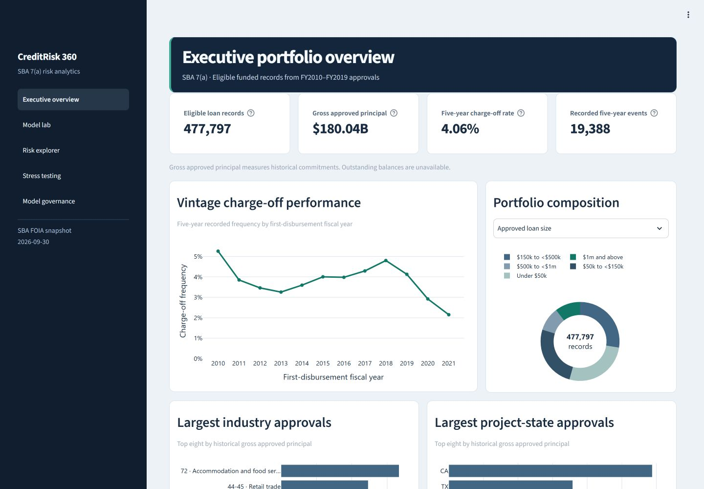
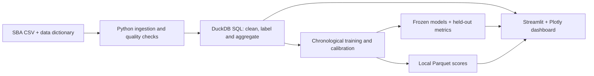

# CreditRisk 360

**SBA 7(a) loan risk analytics and stress testing**

Small-business lending teams need to know where credit risk is concentrating and which loans to review first. CreditRisk 360 uses public SBA data to rank five-year recorded charge-off risk, compare performance across vintages, and test how hypothetical shocks change portfolio risk.



### Validated technical highlights

- **DuckDB portfolio build:** 477,797 eligible records, $180.04 billion in historical gross approvals, and 19,388 five-year recorded charge-offs (4.06%).
- **Chronological holdout:** XGBoost reached **0.7165 ROC-AUC**, **0.09508 average precision**, and **0.04185 Brier score** on 103,136 FY2018–2019 first-disbursement records.
- **Risk concentration:** The highest validation-defined risk group captured **30.8% of holdout charge-offs**. The overall prediction averaged 5.19% versus 4.49% observed.
- **Reproducibility:** Two independent data builds matched on the ordered DuckDB fingerprint. All **27 tests passed** in a clean Python environment.

## Data and workflow

The study uses the SBA 7(a) FY2010–FY2019 approvals extract as of **September 30, 2026**. DuckDB validated 545,751 input records, removed 1,136 excess exact copies, and identified funded records whose five-year horizon had closed by the snapshot. Because the extract has no stable loan identifier, exact-row deduplication cannot establish the number of unique underlying loans. [Official SBA dataset](https://data.sba.gov/dataset/7a-504-foia) · [Download and checksums](docs/data_download.md)



The target includes the 60-month anniversary. Records with missing or contradictory outcome histories remain unlabeled. A recorded charge-off may follow the original default. Training-only preprocessing handles missing values, scales numeric inputs, and groups rare categories. The model excludes servicing fields, identifiers, and loan term, whose point-in-time provenance could not be established. [Data quality](docs/data_quality.md) · [Target and leakage decisions](docs/target_and_leakage.md)

## Model results and business implications

The FY2018–2019 first-disbursement holdout contains **103,136 records and 4,631 events (4.49%)**. Hyperparameter tuning and calibration decisions were made on earlier cohorts. Metrics below are in the order **ROC-AUC / average precision / Brier score**.

- **Logistic regression** · **0.7017 / 0.08736 / 0.04222**. An interpretable benchmark with a coefficient export.
- **Random Forest** · **0.7121 / 0.09018 / 0.04191**. A nonlinear benchmark with a separately validated sigmoid mapping.
- **XGBoost** · **0.7165 / 0.09508 / 0.04185**. The retrospective validation choice. The highest risk group contained **30.8%** of holdout events. The model predicted **5.19%** overall against **4.49%** observed.

The gain supports ranking for portfolio monitoring research. Absolute probabilities were less stable by vintage. When development used only records with five-year windows that closed before the holdout began, logistic regression was selected and reached **0.6591 ROC-AUC**. A single 2026 snapshot cannot reconstruct point-in-time data or verify historical revisions. [Metrics](reports/modeling/metrics.csv) · [Technical modeling report](docs/modeling_report.md)

### Scenario analysis

The dashboard scales the holdout mix to an illustrative **$10 million** approved-principal proxy. Multiplying each calibrated probability by **1.00×**, **1.25×**, and **1.75×**, then capping it at 100% before weighting, gives indicators of **2.32%**, **2.90%**, and **4.06%**. The indicator measures modeled event sensitivity. Actual EAD, loss severity, and recoveries are unavailable, so these results cannot estimate expected dollar loss.

## Dashboard

The five pages cover portfolio overview, model validation, segment investigation, stress testing, and model governance. The app uses cached read-only DuckDB queries and frozen Parquet scores.

[Stress testing dashboard](docs/screenshots/stress-testing.jpg) · [Holdout discrimination plots](reports/modeling/discrimination.png) · [Calibration and decile analysis](reports/modeling/calibration_and_deciles.png)

## Run locally

Use **64-bit Python 3.12** on Windows and PowerShell. Download the two SBA files into `data/raw/` following the [data guide](docs/data_download.md). From the project root, run:

```powershell
python -m venv .venv
& .\.venv\Scripts\python.exe -m pip install --only-binary=:all: -r requirements.txt
& .\.venv\Scripts\python.exe -m pip check
$env:MPLCONFIGDIR = Join-Path (Get-Location) '.matplotlib'
& .\.venv\Scripts\python.exe -m creditrisk.pipeline
& .\.venv\Scripts\python.exe -m creditrisk.modeling.train
& .\.venv\Scripts\python.exe -m creditrisk.modeling.evaluate
& .\.venv\Scripts\python.exe -m unittest discover -s tests -v
& .\.venv\Scripts\python.exe -m streamlit run app.py --server.headless true --server.port 8502
```

Open [localhost:8502](http://127.0.0.1:8502). Training freezes the selected models and validation decisions before the separate evaluation command. Rebuild the score artifacts whenever the database or model release changes. The app verifies the saved release checksums before it queries the data.

- [Python source](creditrisk/) · [DuckDB SQL](sql/) · [Streamlit entry point](app.py) · [Application modules](creditrisk/dashboard/) · [Tests](tests/)
- [Release validation](docs/release_validation.md) · [One-page showcase brief](docs/showcase_one_page.md) · [Interview Q&A](docs/interview_qa.md)

Keep raw inputs, local databases, fitted artifacts, and record-level scores out of Git. The public reports contain aggregates. The portfolio CSV omits groups under 10 records.
