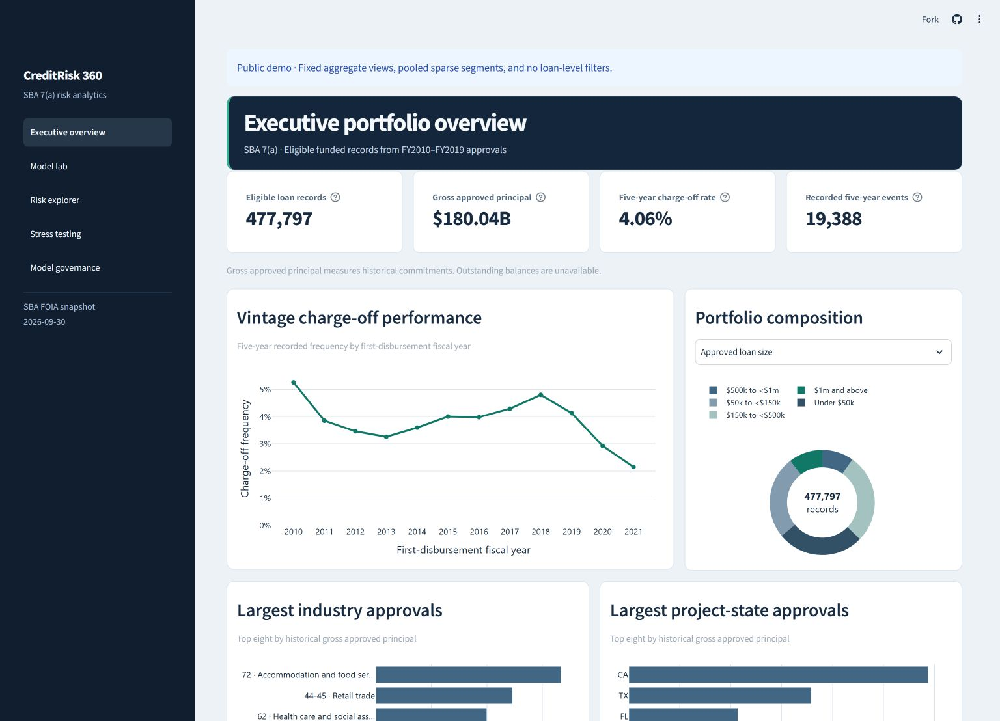
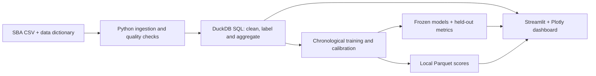
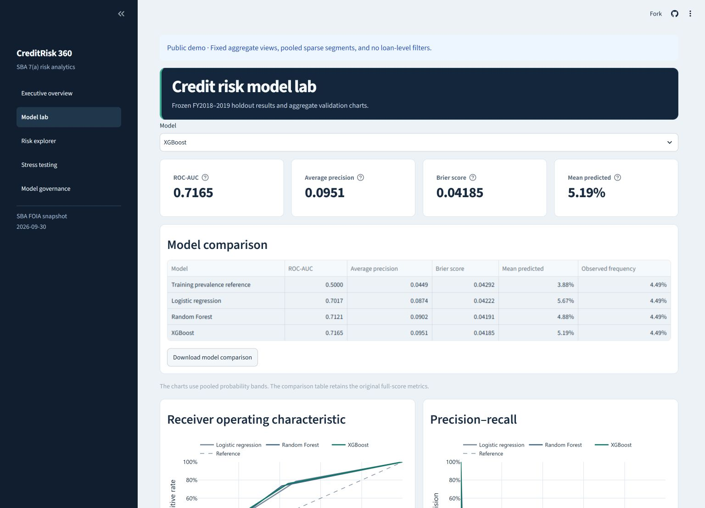
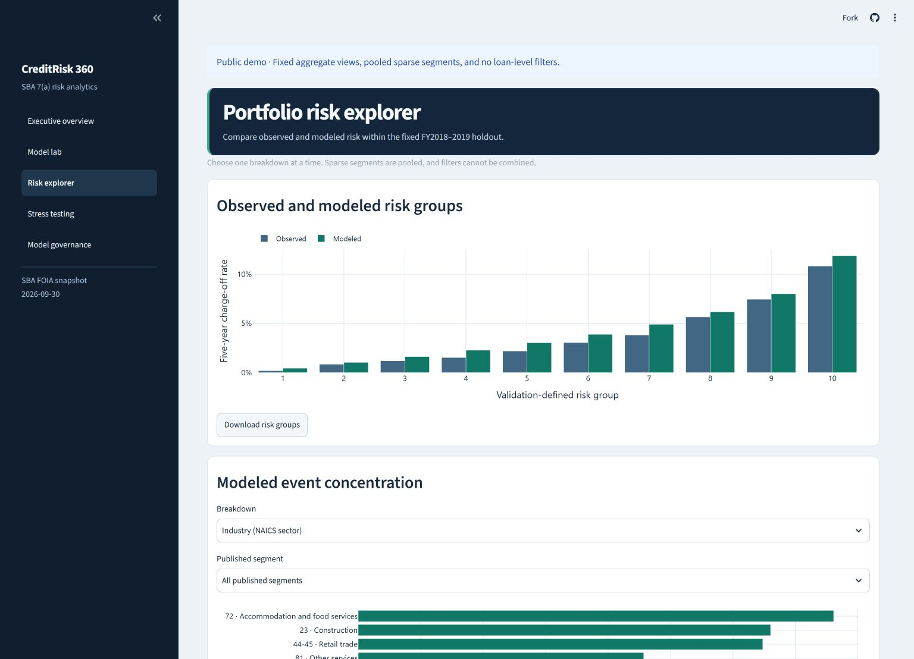
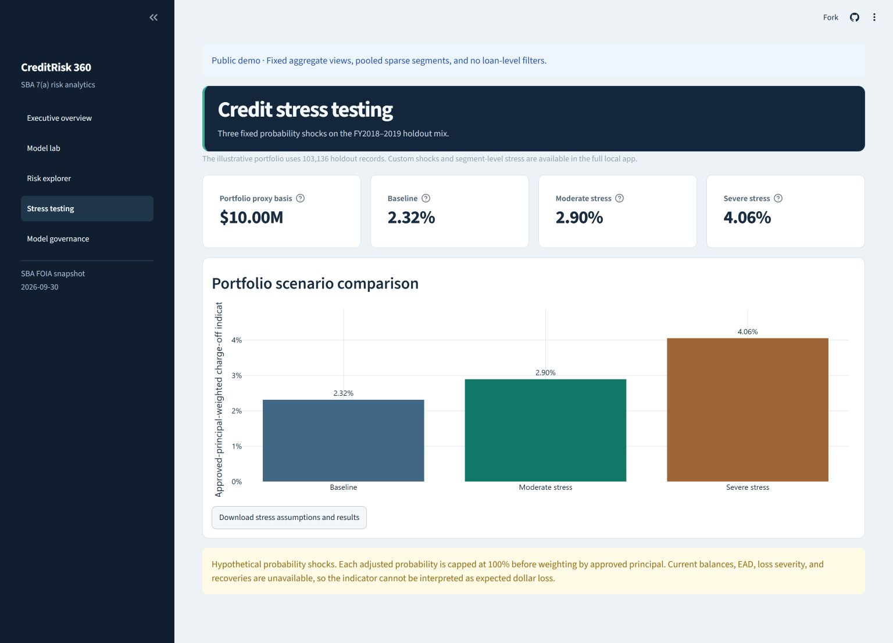
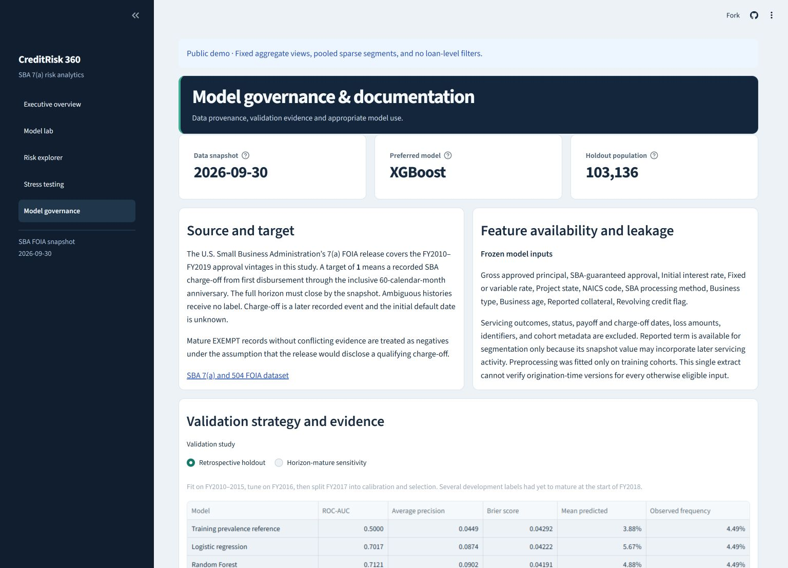

# CreditRisk 360

**Explainable Credit Risk Modeling & Portfolio Stress Analytics**

> When a lender has thousands of small-business loans but limited capacity to investigate them, which accounts should be prioritized for review—and how reliable are those risk estimates?

CreditRisk 360 uses historical SBA 7(a) lending data to study charge-off concentrations, compare risk rankings and probability estimates, and illustrate portfolio sensitivity to hypothetical shocks.

### [Launch the live dashboard](https://creditrisk360-eveittxvutuwaig2upqksd.streamlit.app/)

- **Historical portfolio:** 477,797 eligible records, $180.04 billion in gross approvals, and 19,388 five-year recorded charge-offs (4.06%).
- **Held-out model performance:** XGBoost reached **0.7165 ROC-AUC**, **0.09508 average precision**, and **0.04185 Brier score** on 103,136 FY2018–2019 first-disbursement records.
- **Monitoring signal and caution:** The highest validation-defined risk group captured **30.8% of holdout charge-offs**. XGBoost averaged **5.19% predicted** against **4.49% observed** across the holdout.



## Why this project?

An effective monitoring process needs both a useful ranking and a realistic estimate of how often charge-offs may occur. A false negative can leave a risky loan unflagged. A false positive takes analyst time away from other accounts and can trigger unnecessary review. Calibration matters because an overstated event rate can mislead portfolio planning even when the ranking helps prioritize accounts.

The holdout makes the trade-off concrete. At a **5%** XGBoost threshold, the model flagged **45.54%** of records and caught **76.14%** of recorded charge-offs. At the **8%** validation-selected threshold, it flagged **20.25%** and caught **44.31%**. The right threshold depends on review capacity and the cost of missed events. These figures illustrate the trade-off using historical outcomes. [Confusion matrices](reports/modeling/confusion_matrices.csv)

## Analytical approach

The study uses the SBA 7(a) FY2010–FY2019 approvals extract as of **September 30, 2026**. DuckDB validated 545,751 input records, removed 1,136 excess exact copies, and identified funded records whose five-year horizon had closed by the snapshot. Because the extract has no stable loan identifier, exact-row deduplication cannot establish the number of unique underlying loans. [Official SBA dataset](https://data.sba.gov/dataset/7a-504-foia) · [Download and checksums](docs/data_download.md)



1. **Build the outcome.** DuckDB identifies SBA-recorded charge-offs from first disbursement through the inclusive 60-month anniversary. Records with incomplete follow-up or uncertain outcomes stay unlabeled. A recorded charge-off can occur after the original default.
2. **Screen for leakage.** Data-quality checks reconcile the cohorts and outcomes. Training-only preprocessing handles missing values, scales numeric inputs, and groups rare categories. The feature set excludes servicing fields, identifiers, and reported term, whose point-in-time provenance could not be established.
3. **Compare models on later vintages.** Logistic regression provides readable coefficients and a transparent baseline. Random Forest and XGBoost test whether nonlinear relationships and interactions improve ranking. First-disbursement cohorts govern training, tuning, calibration, and the untouched FY2018–2019 holdout.
4. **Evaluate for monitoring.** Compare ranking and probability accuracy, examine risk groups and portfolio segments, and apply hypothetical probability shocks to illustrate portfolio sensitivity. Global Tree SHAP describes which features influenced the XGBoost scores. It does not establish causes of charge-off.

[Data quality](docs/data_quality.md) · [Target and leakage decisions](docs/target_and_leakage.md) · [Technical modeling report](docs/modeling_report.md)

## Model results and business implications

The FY2018–2019 first-disbursement holdout contains **103,136 records and 4,631 events (4.49%)**. Hyperparameter tuning and calibration decisions were made on earlier cohorts. Metrics below are in the order **ROC-AUC / average precision / Brier score**.

- **Logistic regression** · **0.7017 / 0.08736 / 0.04222**. An interpretable benchmark with a coefficient export.
- **Random Forest** · **0.7121 / 0.09018 / 0.04191**. A nonlinear benchmark with a separately validated sigmoid mapping.
- **XGBoost** · **0.7165 / 0.09508 / 0.04185**. The retrospective validation choice. The highest risk group contained **30.8%** of holdout events. The model predicted **5.19%** overall against **4.49%** observed.

**Ranking helped prioritize review.** ROC-AUC measures how well the model ranks an event record above a non-event record. XGBoost’s average precision of **0.09508** exceeded the **0.04490** no-skill reference in this low-event cohort. The highest risk group contained **1,428 of 4,631** holdout charge-offs across **13,212 of 103,136** records. That shows concentration of recorded events, without establishing whether reviewing those accounts would prevent losses.

**Probability estimates varied by vintage.** The Brier score measures squared probability error, with lower scores preferred. XGBoost had the lowest test Brier score among the three selected models and still overpredicted the overall event rate. The gap was larger in FY2019, at **5.47% predicted versus 4.13% observed**.

**The timing of available outcomes changes the conclusion.** When development was limited to records whose five-year outcomes had matured before the holdout began, validation selected logistic regression. It reached **0.6591 ROC-AUC** on the same holdout. That study also uses an older, smaller development sample. The single 2026 snapshot cannot establish when every feature was available or reconstruct servicing revisions, so the retrospective ranking results support further monitoring research. [Holdout metrics](reports/modeling/metrics.csv) · [Calibration by vintage](reports/modeling/test_by_fiscal_year.csv) · [Cohort audit](reports/modeling/cohort_audit.csv)

### Scenario analysis

The dashboard scales the holdout mix to an illustrative **$10 million** approved-principal proxy. Multiplying each calibrated probability by **1.00×**, **1.25×**, and **1.75×**, then capping it at 100% before weighting, gives indicators of **2.32%**, **2.90%**, and **4.06%**. These are modeled charge-off indicators weighted by historical approvals. The data lacks current balances, default timing, and recovery information needed to support validated regulatory PD, LGD, EAD, or expected dollar loss forecasts.

## Dashboard showcase

The five pages cover portfolio overview, model validation, segment investigation, stress testing, and model governance. The full local app uses cached read-only DuckDB queries and frozen Parquet scores.

The hosted dashboard uses fixed cohort summaries, pooled segments, and preset stress scenarios. The public explorer shows one breakdown at a time, and the model lab uses a fixed threshold alongside the original holdout metrics. Custom thresholds, combined filters, and custom stress scenarios are available in the full local app. [Deployment and disclosure controls](docs/cloud_deployment.md)

[Executive Overview](docs/screenshots/executive-overview.png) · [Model Lab](docs/screenshots/model-lab.png) · [Risk Explorer](docs/screenshots/risk-explorer.png) · [Stress Testing](docs/screenshots/stress-testing.png) · [Model Governance](docs/screenshots/model-governance.png)

<details>
<summary>View the four supporting dashboard screenshots</summary>

#### Model Lab



#### Risk Explorer



#### Stress Testing



#### Model Governance



</details>

[Holdout discrimination plots](reports/modeling/discrimination.png) · [Calibration and decile analysis](reports/modeling/calibration_and_deciles.png)

## Run locally

Use **64-bit Python 3.12** on Windows and PowerShell. Download the two SBA files into `data/raw/` following the [data guide](docs/data_download.md). From the project root, run:

```powershell
python -m venv .venv
& .\.venv\Scripts\python.exe -m pip install --only-binary=:all: -r requirements-local.txt
& .\.venv\Scripts\python.exe -m pip check
$env:MPLCONFIGDIR = Join-Path (Get-Location) '.matplotlib'
& .\.venv\Scripts\python.exe -m creditrisk.pipeline
& .\.venv\Scripts\python.exe -m creditrisk.modeling.train
& .\.venv\Scripts\python.exe -m creditrisk.modeling.evaluate
& .\.venv\Scripts\python.exe -m unittest discover -s tests -v
& .\.venv\Scripts\python.exe -m streamlit run app.py --server.headless true --server.address 127.0.0.1 --server.port 8502
```

Open [localhost:8502](http://127.0.0.1:8502). Training freezes the selected models and validation decisions before the separate evaluation command. Rebuild the score artifacts whenever the database or model release changes. The app verifies the saved release checksums before it queries the data.

Two independent data builds matched on the ordered DuckDB fingerprint. The original clean-environment review passed 27 tests, and the later public-demo review passed 33 in the full local workspace. [Release validation](docs/release_validation.md) · [Public-demo validation](docs/cloud_deployment.md#validation-completed)

- [Python source](creditrisk/) · [DuckDB SQL](sql/) · [Streamlit entry point](app.py) · [Application modules](creditrisk/dashboard/) · [Tests](tests/)
- [Release validation](docs/release_validation.md) · [One-page showcase brief](docs/showcase_one_page.md) · [Interview Q&A](docs/interview_qa.md)

Keep raw inputs, local databases, fitted artifacts, and record-level scores out of Git. The public reports contain aggregates. The portfolio CSV omits groups under 10 records.
